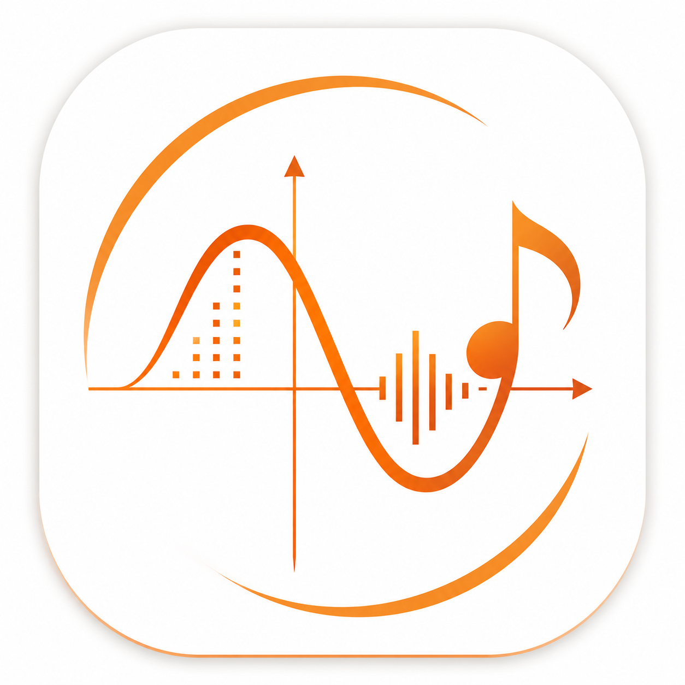
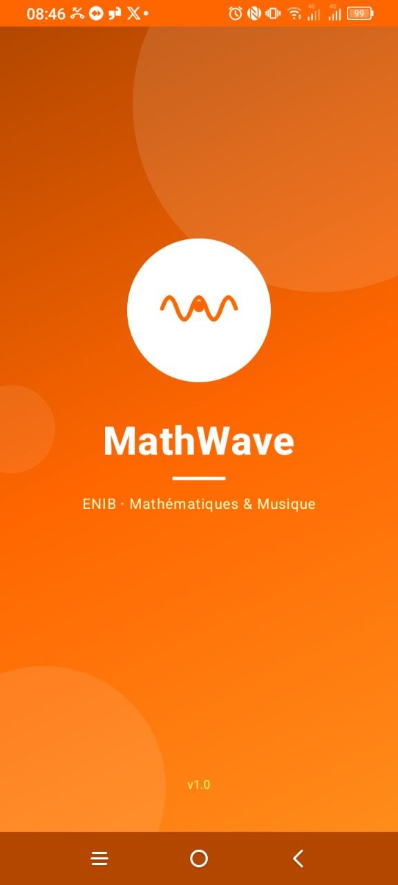
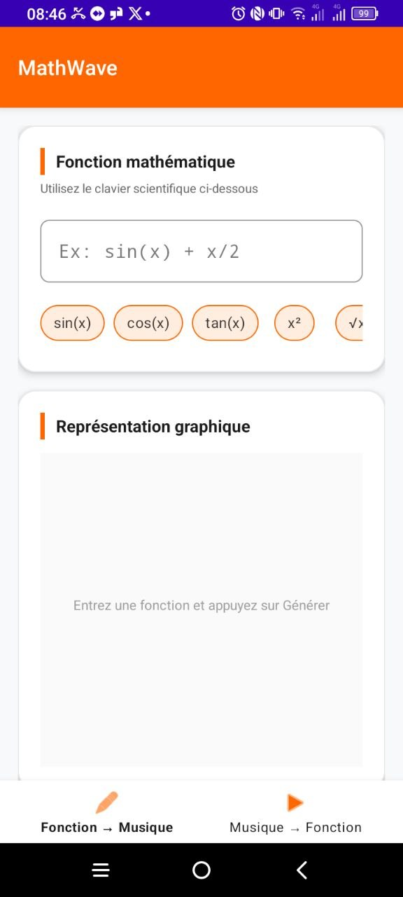
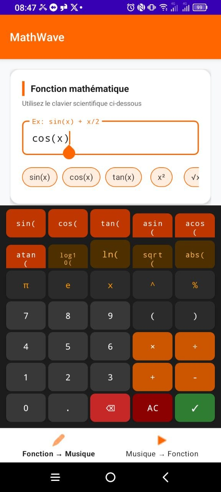
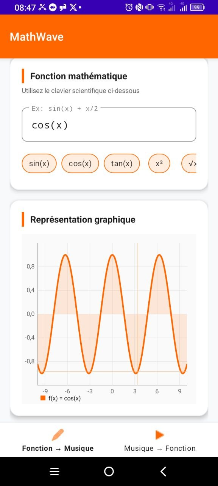
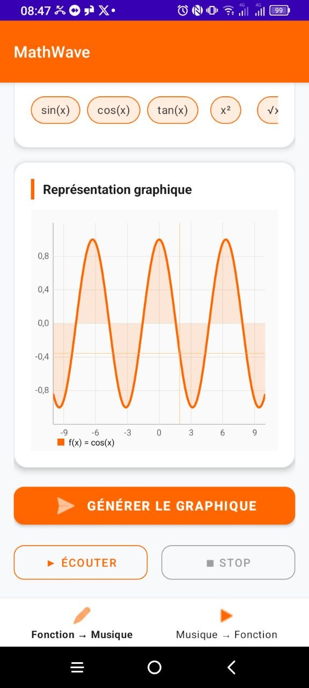
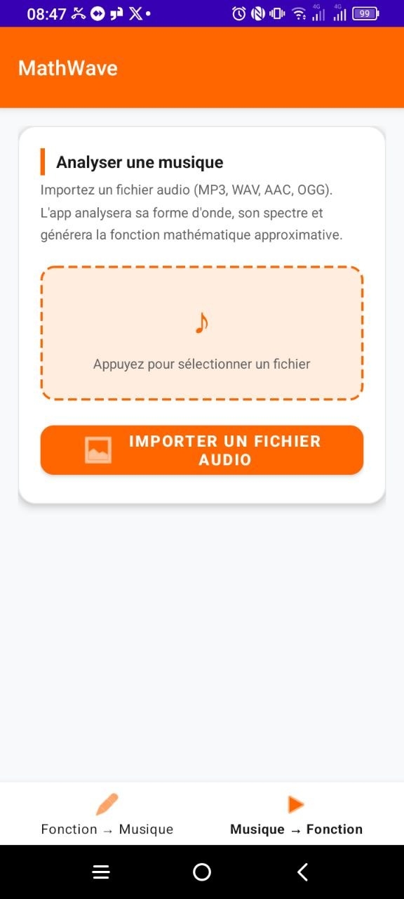
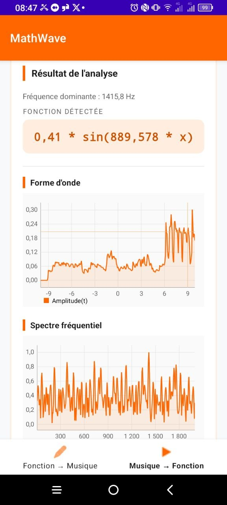

<div align="center">



# MathWave

**Convertisseur bidirectionnel entre fonctions mathématiques et musique**

[](https://developer.android.com)
[](https://developer.android.com/about/versions/nougat)
[](https://openjdk.org)
[](https://kotlinlang.org)
[](LICENSE)


</div>

---

## À propos

**MathWave** est une application Android développée dans le cadre du projet ENIB (*École Nationale d'Ingénieurs de Brest*). Elle explore le lien fascinant entre les mathématiques et la musique en permettant deux conversions bidirectionnelles :

- **Fonction → Musique** : Saisissez une fonction mathématique, visualisez son graphe et écoutez sa sonification.
- **Musique → Fonction** : Importez un fichier audio, analysez sa forme d'onde via FFT et obtenez la fonction mathématique approchée.

---

## Aperçu

<div align="center">

| Splash Screen | Écran principal | Clavier scientifique |
|:---:|:---:|:---:|
|  |  |  |

| Graphe de la fonction | Génération du son | Importation audio |
|:---:|:---:|:---:|
|  |  |  |

| Résultat de l'analyse (forme d'onde + spectre FFT) |
|:---:|
|  |

</div>

---

## Fonctionnalités

### Fonction → Musique
- **Courbe sonore** avec hauteur et volume liés à la fonction
- **Percussions** calculées à partir des variations, sommets et creux
- **Curseur et point lumineux synchronisés** sur la position de lecture Android
- **Six exemples** pour explorer plusieurs comportements, dont un ECG
- **Intervalle et durée réglables** de 2 à 30 secondes
- **Commandes Tracer, Écouter et Stop accessibles ensemble**, en portrait et en paysage
- **Calcul audio en arrière-plan**, avec annulation des requêtes remplacées
- **Clavier scientifique** dédié avec 35 touches : trigonométrie (sin, cos, tan, asin, acos, atan), logarithmes (log, ln, log10), racines, valeur absolue, constantes π et e
- **Chips de raccourcis** pour les fonctions courantes : `sin(x)`, `cos(x)`, `tan(x)`, `x²`, `sqrt(x)`
- **Visualisation graphique interactive** avec zoom et déplacement sur la fonction générée
- **Sonification de la fonction** en PCM 44 100 Hz, 16 bits, avec fondu aux raccords
- Validation en temps réel de l'expression mathématique

### Musique → Fonction
- **Import de fichiers audio** : MP3, WAV, AAC, OGG
- **Décodage PCM** via MediaExtractor + MediaCodec (multi-canaux → mono)
- **Analyse FFT** (Cooley-Tukey, 8192 points, fenêtrage de Hann)
- **Extraction de la fréquence dominante** (plage 20–8000 Hz)
- **Affichage de la forme d'onde** et du **spectre fréquentiel** (jusqu'à 2000 Hz)
- **Fonction mathématique approchée** générée automatiquement : `amplitude × sin(ω × x)`

---

## Architecture

```
app/src/main/java/com/example/enib/
├── MainActivity.java               # Activité principale + navigation par onglets
├── SplashActivity.java             # Écran de démarrage animé
├── domain/
│   ├── AudioAnalyzer.java          # Décodage audio + analyse FFT
│   ├── MathFunctionParser.java     # Parsing et évaluation d'expressions (exp4j)
│   ├── TimelineSignal.java        # Échantillonnage, hauteur, volume et accents
│   ├── MathSonifier.java           # Génération audio à partir d'une fonction
│   └── SimpleFFT.java              # Implémentation FFT Cooley-Tukey radix-2
└── ui/
    ├── math/
    │   ├── MathInputFragment.java  # Écran Fonction → Musique
    │   └── MathKeyboardView.java   # Clavier scientifique custom
    └── music/
        └── MusicImportFragment.java # Écran Musique → Fonction
```

---

## Technologies utilisées

| Bibliothèque | Version | Rôle |
|---|---|---|
| **AndroidX Navigation** | 2.7.7 | Navigation entre fragments (bottom nav) |
| **Material Design 3** | 1.11.0 | Composants UI modernes |
| **MPAndroidChart** | v3.1.0 | Visualisation des graphes et spectres |
| **exp4j** | 0.4.8 | Parsing d'expressions mathématiques |
| **MediaCodec / MediaExtractor** | Android API | Décodage audio natif |

---

## Prérequis

- Android Studio Hedgehog (ou supérieur)
- Android SDK API 24+ (Android 7.0 Nougat)
- JDK 21, utilisé pour la compilation vérifiée

---

## Installation

### 1. Cloner le dépôt

```bash
git clone https://github.com/ItxMveng/MathWave.git
cd MathWave
```

### 2. Ouvrir dans Android Studio

```
File → Open → sélectionner le dossier MathWave
```

### 3. Synchroniser Gradle

```
Tools → Sync Project with Gradle Files
```

### 4. Lancer l'application

Connectez un appareil Android (API 24+) ou démarrez un émulateur, puis cliquez sur **Run ▶**.

---

## Permissions requises

| Permission | Usage |
|---|---|
| `READ_MEDIA_AUDIO` (API ≥ 33) | Accès aux fichiers audio |
| `READ_EXTERNAL_STORAGE` (API ≤ 32) | Accès aux fichiers audio (appareils anciens) |

---

## Fonctionnement technique

### Sonification d’une fonction
1. La fonction est évaluée sur l’intervalle choisi. Les zones indéfinies sont silencieuses.
2. Une compression logarithmique signée conserve les différences d’amplitude entre les fonctions.
3. Le mode Courbe sonore utilise les valeurs pour piloter la hauteur et le volume, avec des accents calculés sur les variations.
4. Le mode Percussions transforme les variations de la courbe en frappes.
5. Le son est préparé en arrière-plan puis diffusé avec AudioTrack.
6. Le curseur et l’animation suivent les horodatages de lecture Android, avec repli sur la position de lecture.

### Essayer cette version
Ouvrir Fonction → Musique, choisir un exemple puis toucher Écouter. Pour une formule personnelle, toucher le champ, saisir l’expression et toucher Tracer ou Écouter. Les réglages permettent de choisir l’intervalle de x et la durée.

La compilation assembleDebug et l’analyse lintDebug ont été vérifiées. La saisie, la lecture, l’arrêt et les rotations portrait et paysage ont été testés sur un émulateur Android. Le moteur audio a également été vérifié sur les différences entre fonctions, les domaines négatifs et indéfinis, les variations de durée et les limites PCM.

### Analyse FFT d'un fichier audio
1. Le fichier est décodé en PCM mono via MediaCodec.
2. Une fenêtre de Hann est appliquée sur 8192 échantillons.
3. La FFT Cooley-Tukey (radix-2) calcule le spectre de fréquences.
4. La fréquence dominante (20–8 000 Hz) est extraite.
5. La fonction approchée `A × sin(ω × x)` est générée.

---

## Auteur

Développé avec passion dans le cadre d'un projet académique à l'**ENIB** — *École Nationale d'Ingénieurs de Brest*.

---

## Licence

Ce projet est distribué sous licence [MIT](LICENSE).
